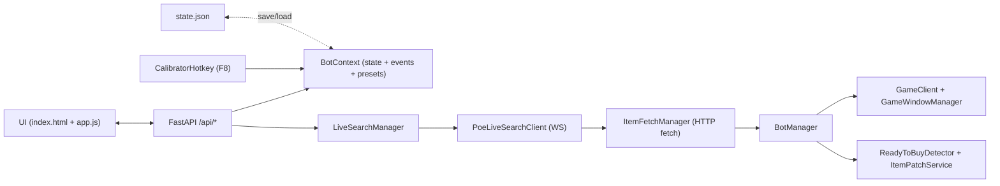
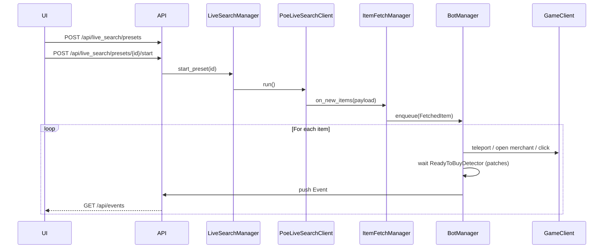

# PoE Trade Bot (TradeBotWS)

Публичная версия проекта для портфолио. Локальные cookies и настройки из
`app/state.json` не входят в репозиторий; пустой пример находится в
`app/state.json.example`. При первом запуске авторизационные данные задаются
через интерфейс и сохраняются только локально.

PoE Trade Bot — это десктопный помощник для **Path of Exile**, который автоматически отслеживает предложения полученые из **live search**(официальный функция сайта Path of exile, которая отслеживает новые предметы и передает их по Web socket) и помогает быстро реагировать на появление выгодных предметов.
На данный момент реализовано 2 режима работы:
- Режим **ONLY_TP**: 
Бот автоматически телепортируется в хайдаут / к продавцу, а покупку делаешь вручную(Используется в случаях, когда не ясно стоит ли покупать предмет).
- Режим **AUTOBUY**:
Бот сам пытается купить предмет:  кликает по нужным слотам(в которых лежит предмет) и через сравнение **патчей картинки** проверяет, что предмет всё ещё лежит у продавца, либо куплен

Backend написан на **FastAPI** вокруг глобального контекста `BotContext`.  
Поверх него — сервисы для:

- управления live search пресетами;
- получения предметов из WS от PoE trade;
- очереди предметов для обработки ботом;
- управления окном игры и вводом (мышь/клавиатура);
- калибровки сеток (merchant / inventory);
- компьютерное зрение.

Фронт(UI) — SPA на **HTML + Tailwind + чистый JS** (`ui/index.html` + `ui/static/app.js`)

---
## 0. Оглавление
- [1. Быстрый старт](#1-быстрый-старт)
  - [1.1. Установка в виртуальное окружение](#11-установка-в-виртуальное-окружение)
  - [1.2. Запуск ](#12-запуск-backend--ui)
  - [1.3. Первичная настройка в-ui](#13-первичная-настройка-в-ui)
- [2. Архитектура (Слоистая)](#2-архитектура-слоистая)
  - [2.1. Структура проекта (основные файлы)](#21-структура-проекта-основные-файлы)
- [3. Domain слой](#3-domain-слой)
  - [3.1. Модели (domainmodelspy)](#31-модели-domainmodelspy)
  - [3.2. Глобальное состояние (domainstatepy)](#32-глобальное-состояние-domainstatepy)
- [4. Services](#4-services)
  - [4.1. BotManager](#41-botmanager)
  - [4.2. LiveSearchManager--itemfetchmanager](#42-livesearchmanager--itemfetchmanager)
- [5. Infra слой](#5-infra-слой)
  - [5.1. PatchMatcher](#51-patchmatcher)
- [6. API слой (FastAPI)](#6-api-слой-fastapi)
  - [6.1. Auth ](#61-auth-routes_authpy)
  - [6.2. Статус и события ](#62-статус-и-события-routes_statuspy)
  - [6.3. Live Search ](#63-live-search-routes_live_searchpy)
  - [6.4. Grid ](#64-grid-routes_gridpy)
- [7. Web UI ](#7-web-ui-appui) 
- [8. Жизненный цикл live search пресета](#8-жизненный-цикл-live-search-пресета)
- [9. Конфигурация и state](#9-конфигурация-и-state)
  - [9.1. config.py](#91-configpy)
  - [9.2. storage.py и state.json](#92-storagepy-и-statejson)
- [10. Зависимости и окружение](#10-зависимости-и-окружение)
- [11. Отладка и логирование](#11-отладка-и-логирование)

---
## 1. Быстрый старт
#### 1.1. Установка в виртуальное окружение

```bash
# 1. Клонирование
git clone https://github.com/Gidemin03/TradeBotWS-portfolio.git
cd TradeBotWS-portfolio

# 2. Виртуальное окружение
python -m venv .venv
.venv\Scripts\activate  # для Windows

# 3. Установка зависимостей (примерный список)
pip install fastapi "uvicorn[standard]" aiohttp websockets pydantic numpy mss PySide6 keyboard pyautogui
```

> Рекомендуется вынести итоговый набор пакетов в `requirements.txt`.

#### 1.2. Запуск backend + UI

```bash
cd <repo-root>
python -m app.main
# либо явно:
uvicorn app.main:app --host 127.0.0.1 --port 5000
```

После старта:

- открыть в браузере `http://127.0.0.1:5000/`;
- появится веб-интерфейс бота.


---
#### 1.3. Первичная настройка в UI

1. **Ввод cookies PoE**

   - В соответствующем блоке UI указать:
     - `POESESSID`;
     - `cf_clearance` (если требуется).
   - Нажать «Сохранить» — отправится `POST /api/auth/cookies`.

2. **Калибровка сеток**

   - Запустить `ui/grid_calibrator.py` (или соответствующую кнопку в UI, если есть).
   - Подогнать рамки merchant / inventory под своё окно игры.
   - Сохранить значения в backend через `/api/grid/*`.

3. **Создание и запуск пресетов**

   - На главной странице:
     - заполнить форму (URL live search, имя, режим);
     - нажать «Добавить»;
     - через таблицу пресетов запустить нужный пресет (или все сразу).
   - Статусы и события можно смотреть в правом/нижнем блоке UI.

---

## 2. Архитектура (Слоистая)




#### 2.1 Структура проекта (основные файлы)
```
app/
  main.py                 # точка входа FastAPI
  config.py               # константы/тайминги
  storage.py              # load/save state.json
  state.json              # персист пресетов/cookies/сеток/патчей

  domain/
    models.py             # модели, enums, сетки, патчи
    state.py              # BotContext (in-memory)

  infra/
    http_session.py       # HttpSessionFactory (aiohttp)
    poe/
      web_client.py       # PoE WS + teleport_to_hideout
      game_client.py      # ввод/окно, AUTOBUY
    input/
      mouse_keyboard.py   # заглушка
    ui/
      calibrator_launcher.py # F8-хук для калибратора
    vision/
      patch_matcher.py    # сравнение патчей инвентаря

  services/
    live_search_manager.py    # CRUD и жизненный цикл пресетов
    item_fetch_manager.py     # очередь fetch
    bot_manager.py            # очередь предметов, TP/AUTOBUY
    game_window_manager.py    # активация окна PoE (WinAPI)
    merchant_grid_service.py  # доступ к сеткам
    item_patch_service.py     # захват/сравнение патча merchant-слота
    ready_to_buy_detector.py  # READY по патчам инвентаря

  api/
    routes_status.py      # /health, /status, /events
    routes_live_search.py # CRUD пресетов + старт/стоп(все) + смена режима
    routes_auth.py        # /auth/cookies
    routes_grid.py        # /grid

  ui/
    index.html            # интерфейс
    static/app.js         # клиентская логика (polling API)
```

---

| Слой        | Папка       | Ответственность                                                                 |
|-------------|-------------|---------------------------------------------------------------------------------|
| **UI**      | `ui/`       | Статика и HTML, управление ботом из браузера.                                   |
| **API**     | `api/`      | REST / JSON endpoints на FastAPI.                                              |
| **Domain**  | `domain/`   | Pydantic-модели и глобальное состояние `BotContext`.                            |
| **Services**| `services/` | Высокоуровневые сервисы: бот, live search, калибровка сеток, патчи, WS и т.д.   |
| **Infra**   | `infra/`    | Низкоуровневые обёртки: HTTP-сессии, PoE WebSocket клиент, ввод, vision.       |
| **Storage** | `storage.py`| Сериализация/десериализация `BotContext` в `state.json`.                        |
| **Config**  | `config.py` | Все магические числа и флаги (тайминги, пороги, настройки окна игры и т.д.).   |

---

## 3. Domain слой

#### 3.1. Модели (`domain/models.py`)

Основные модели:

| Модель              | Описание |
|---------------------|----------|
| `BotStatus`         | Статус бота: `IDLE`, `IN_TELEPORTING`, `BUSY`. Хранится в `BotContext.bot_status`. |
| `MerchantGrid`      | Нормализованная сетка **торговца** в долях экрана (`left/top/right/bottom`, `rows=12`, `cols=12`, плюс `screen_width/height`). |
| `InventoryGrid`     | Нормализованная сетка **инвентаря** в долях экрана (`rows=5`, `cols=12`). |
| `InventoryPatch`    | Один патч/слот инвентаря (id, координаты, hash, base64-данные, серый массив и т.д.). |
| `InventoryPatches`  | Набор патчей, хранимый/сериализуемый (эталонное состояние инвентаря). |
| `FetchedItem`       | Описание найденного предмета из live search: к какому пресету относится, какой item_id, hideout_token, координаты в стэше (`stash_x/stash_y`). |
| `LiveSearchStatus`  | Статус пресета live search: `STOPPED`, `CONNECTING`, `SEARCHING`, `ERROR`. |
| `LiveSearchMode`    | Режим пресета: `ONLY_TP` или `AUTOBUY`. |
| `LiveSearchPreset`  | Конфигурация одного пресета: `id`, `name`, `url`, `mode`, `status`. Есть фабрика `from_url(...)`. |
| `EventLevel`        | Уровень события: `INFO`, `WARNING`, `ERROR`. |
| `Event`             | Событие для UI: уровень + текст сообщения. Используется как внутренняя «лента логов». |

#### 3.2. Глобальное состояние (`domain/state.py`)
BotContext (файл domain/state.py) — это pydantic-модель, которая:
 - Хранит всё текущее состояние бота: статус, пресеты, события, калибровку сеток, патчи, авторизационные данные.

 - Живёт в app.state.context внутри FastAPI-приложения.

 - Сериализуется/десериализуется через storage.py в файл state.json, чтобы между перезапусками не терять состояние.

 по сути единственный источник правды о состоянии бота. Все сервисы и API-роуты читают и изменяют именно его, а затем он сохраняется в state.json.

---

## 4. Services

Папка `app/services/`:

| Файл                         | Сервис / роль |
|------------------------------|---------------|
| `bot_manager.py`             | `BotManager` — координирует обработку предметов: забирает их из очереди, вызывает `GameClient`, дергает `ReadyToBuyDetector`, пишет события, обновляет статус бота. |
| `game_window_manager.py`     | `GameWindowManager` — управление окном PoE через WinAPI: активирует, возвращает фокус, даёт задержку на перерисовку. Использует флаги из `config.py` (`ACTIVATE_GAME_WINDOW`, `GAME_WINDOW_ACTIVATION_DELAY`). |
| `item_fetch_manager.py`      | `ItemFetchManager` — получает предметы из live search (через `PoeLiveSearchClient`), дедуплицирует и отправляет новые предметы в `BotManager`. |
| `item_patch_service.py`      | `ItemPatchService` — работает с патчами картинок: конвертирует слоты в прямоугольники, снимает патчи, сравнивает по MSE/корреляции с порогами из `config.py`. |
| `live_search_manager.py`     | `LiveSearchManager` — управляет жизненным циклом live search пресетов: запуск/остановка WS-клиентов, смена статуса пресета, обработка ошибок. |
| `merchant_grid_service.py`   | `MerchantGridService` — хранит и валидирует сетки merchant/inventory в `BotContext`, переводит координаты слотов в реальные координаты экрана. |
| `ready_to_buy_detector.py`   | `ReadyToBuyDetector` — асинхронно следит за состоянием инвентаря через патчи и решает, «готово ли» к следующему действию. |

#### 4.1. BotManager

Главные ответственности `BotManager`:

- держит очередь `Deque[FetchedItem]` для предметов от `ItemFetchManager`;
- контролирует `BotStatus` (IDLE / BUSY / IN_TELEPORTING);
- перед началом действия активирует окно игры через `GameWindowManager`;
- в режиме `ONLY_TP`:
  - выполняет необходимые действия по телепорту (например, `/hideout`, переход к продавцу и т.п.);
- в режиме `AUTOBUY`:
  - телепортируется к продавцу;
  - открывает нужный стэш/окно торговца;
  - кликает по нужному слоту;
  - через `ReadyToBuyDetector` + `ItemPatchService` убеждается, что предмет всё ещё лежит / появился в инвентаре;
- пишет событийные сообщения в `BotContext.events` (старт/успех/ошибки).

#### 4.2. LiveSearchManager + ItemFetchManager

`LiveSearchManager`:

- хранит соответствие `preset_id -> asyncio.Task` для запущенных WS-подписок;
- умеет:

  - `start_preset(preset_id)`
  - `stop_preset(preset_id)`
  - `start_all() / stop_all()`

- на запуске:

  - ставит пресету статус `CONNECTING`;
  - создаёт `PoeLiveSearchClient` и запускает его через `asyncio.create_task`;
  - клиент подключается к PoE live search WS, читает сообщения и отдаёт их в `ItemFetchManager`.

`ItemFetchManager`:

- принимает сырые ответы от PoE WS;
- парсит JSON, превращает в `FetchedItem`;
- делает дедупликацию по item_id / preset_id;
- передаёт новые предметы в `BotManager`.

---

## 5. Infra слой

Папка `app/infra/`:

| Файл / папка             | Назначение |
|--------------------------|-----------|
| `http_session.py`        | `HttpSessionFactory` — фабрика `aiohttp.ClientSession`, общие настройки HTTP (таймауты, заголовки, cookies). |
| `poe/web_client.py`      | `PoeLiveSearchClient` — WebSocket-клиент для PoE live search (использует библиотеку `websockets`, реализует reconnect/backoff). |
| `poe/game_client.py`     | `GameClient` — высокоуровневые действия в игре: отправка команд в чат, телепорт в хайдаут, взаимодействие с NPC, клики по инвентарю и торговцу. Опирается на `input/mouse_keyboard.py` и размеры окна. |
| `input/mouse_keyboard.py`| Низкоуровневый ввод через `pyautogui`, `keyboard` и/или WinAPI: движение/клики мыши, нажатия клавиш. |
| `vision/patch_matcher.py`| `PatchMatcher` — преобразование регионов кадров в градации серого и сравнение их по MSE/норм.MSE/корреляции. |
| `ui/calibrator_launcher.py` | Запуск отдельного окна калибратора (`ui/grid_calibrator.py`) для настройки сеток inventory/merchant. |

#### 5.1. PatchMatcher

`infra/vision/patch_matcher.py`:

- переводит RGB-данные в серое (`_to_gray_rgba`);
- умеет считать:

  - **MSE** между текущим и эталонным патчем;
  - **нормированный MSE** (после нормировки на [0..1]);
  - **корреляцию** между нормализованными патчами;

- логика матчинга:

```python
match = (
    mse <= mse_threshold
    or (norm_mse <= mse_threshold and corr >= corr_threshold)
)
```

Эта логика используется как для инвентаря (`InventoryPatches`), так и для патчей торговца (через `ItemPatchService`).

---

## 6. API слой (FastAPI)

Папка `app/api/`:

| Файл                 | Описание |
|----------------------|----------|
| `routes_auth.py`     | Роуты для авторизационных cookies PoE (`POESESSID`, `cf_clearance`). |
| `routes_grid.py`     | Роуты для калибровки и получения сеток merchant/inventory. |
| `routes_live_search.py` | CRUD и управление live search пресетами (создание, запуск/остановка, смена режима, удаление). |
| `routes_status.py`   | Краткий статус бота и получение ленты событий. |
| `__init__.py`        | Регистрация роутеров в приложении. |

Примеры основных эндпоинтов:

#### 6.1. Auth (`routes_auth.py`)

| Метод | Путь               | Назначение |
|-------|--------------------|-----------|
| `GET` | `/api/auth/cookies`| Получить текущие cookies (`poe_sessid`, `cf_clearance`) из `BotContext`. |
| `POST`| `/api/auth/cookies`| Обновить cookies и сразу записать в `state.json`. |

#### 6.2. Статус и события (`routes_status.py`)

| Метод | Путь          | Ответ (основное)                                         |
|-------|---------------|----------------------------------------------------------|
| `GET` | `/api/status` | `{"bot_status": "...", "live_search_presets_count": n, "events_count": m}` |
| `GET` | `/api/events` | Массив `Event` — события от бота для UI.                |

#### 6.3. Live Search (`routes_live_search.py`)

| Метод  | Путь                                      | Назначение |
|--------|-------------------------------------------|-----------|
| `GET`  | `/api/live_search/presets`                | Список всех пресетов (`LiveSearchPreset`). |
| `POST` | `/api/live_search/presets`                | Создать пресет из `{ url, name?, mode }`.  |
| `POST` | `/api/live_search/presets/{id}/start`     | Запустить WS-подписку для одного пресета.  |
| `POST` | `/api/live_search/presets/{id}/stop`      | Остановить подпись пресета.                |
| `POST` | `/api/live_search/presets/start_all`      | Запустить все пресеты.                     |
| `POST` | `/api/live_search/presets/stop_all`       | Остановить все пресеты.                    |
| `PATCH`| `/api/live_search/presets/{id}/mode`      | Изменить режим (`only_tp` / `autobuy`).    |
| `DELETE`| `/api/live_search/presets/{id}`          | Удалить пресет.                            |

#### 6.4. Grid (`routes_grid.py`)

| Метод | Путь                   | Назначение |
|-------|------------------------|-----------|
| `GET` | `/api/grid/merchant`   | Получить текущую merchant grid. |
| `POST`| `/api/grid/merchant`   | Сохранить merchant grid.         |
| `GET` | `/api/grid/inventory`  | Получить текущую inventory grid. |
| `POST`| `/api/grid/inventory`  | Сохранить inventory grid.        |

При сохранении выполняется валидация: координаты в `[0, 1]`, `rows/cols > 0`, минимальный размер ячейки в пикселях.

---

## 7. Web UI (`app/ui/`)

- `ui/index.html` — HTML-страница, Tailwind через CDN. Основные блоки:
  - список пресетов (таблица с режимом, статусом, контролами старт/стоп, удаление);
  - форма добавления нового пресета (URL, название, режим);
  - блок статуса бота (`idle/busy/in_teleporting`) с цветовой индикацией;
  - блок статистики по пресетам (count / success rate — можно доработать);
  - лента событий.
- `ui/static/app.js` — JS-логика:
  - периодический опрос `/api/status` и `/api/events`;
  - работа с `/api/live_search/presets*` (создание, запуск, остановка, смена режима, удаление);
  - работа с `/api/auth/cookies`;
  - рендер таблиц/иконок статуса и т.д.
- `ui/grid_calibrator.py` — отдельное Python-окно, позволяющее интерактивно настроить `MerchantGrid` и `InventoryGrid`, затем отправить их в backend через `routes_grid.py`.

---

## 8. Жизненный цикл live search пресета

1. **Создание пресета**

   - Пользователь в UI вводит URL live search, имя и режим (`only_tp` / `autobuy`).
   - JS делает:

     ```http
     POST /api/live_search/presets
     ```

   - Backend создаёт `LiveSearchPreset` через `LiveSearchPreset.from_url(...)`, присваивает UUID id и сохраняет в `BotContext.live_search_presets`.

2. **Запуск пресета**

   - Для одного пресета: `POST /api/live_search/presets/{id}/start`.  
   - Для всех — `POST /api/live_search/presets/start_all`.
   - `LiveSearchManager` создаёт и запускает `PoeLiveSearchClient` как `asyncio.Task`.
   - Статус пресета меняется: `STOPPED → CONNECTING → SEARCHING`.

3. **Получение предметов**

   - `PoeLiveSearchClient` подключается по WebSocket к PoE live search и слушает события.
   - Новые результаты переводятся в `FetchedItem` и передаются в `ItemFetchManager`.
   - `ItemFetchManager` делает дедупликацию и кладёт новые предметы в очередь `BotManager`.

4. **Обработка предмета ботом**

   - `BotManager`:

     - переводит `BotStatus` в `IN_TELEPORTING` / `BUSY`;
     - активирует окно PoE (если включено в `config.ACTIVATE_GAME_WINDOW`);
     - в режиме `ONLY_TP` выполняет нужный телепорт и фиксирует событие;
     - в режиме `AUTOBUY` телепортируется, открывает нужные окна и кликает по нужному слоту.

   - После кликов:

     - `ReadyToBuyDetector` следит за **инвентарём** по `InventoryPatches`:
       - через каждые `READY_CHECK_INTERVAL` секунд проверяет патчи;
       - если `READY_CONSECUTIVE_MATCHES` раз подряд патчи совпали по порогам (`READY_MSE_THRESHOLD`, `READY_CORR_THRESHOLD`), он считает, что состояние стабилизировалось (успешный/неуспешный результат покупки).

5. **Завершение обработки**

   - При успехе/ошибке:

     - `BotManager` возвращает `BotStatus` в `IDLE`;
     - в `BotContext.events` добавляется `Event` (`INFO` / `WARNING` / `ERROR`);
     - статистика по пресету обновляется (может быть использована в UI в блоке статистики).



---

## 9. Конфигурация и state

#### 9.1. `config.py`

Все основные настройки собраны здесь:

- **Сервер:**
  - `SERVER_PORT` — порт FastAPI / UI (по умолчанию 5000).
- **Окно игры:**
  - `ACTIVATE_GAME_WINDOW` — включать ли автоактивацию окна PoE.
  - `GAME_WINDOW_ACTIVATION_DELAY` — задержка после фокуса, чтобы игра успела перерисоваться.
- **Ready To Buy:**
  - `READY_CHECK_INTERVAL` — как часто проверять инвентарь (в секундах).
  - `READY_CONSECUTIVE_MATCHES` — сколько подряд совпадений нужно, чтобы считать состояние «готовым».
  - `READY_MSE_THRESHOLD`, `READY_CORR_THRESHOLD` — пороги матчинга патчей.
- **Autobuy / патчи:**
  - `AUTOBUY_MOVE_WAIT` — задержка между действиями в режиме AUTOBUY.
  - `MERCHANT_PATCH_SCALE` — размер патча относительно ячейки (0..1, центр).
  - `MERCHANT_PATCH_MSE_THRESHOLD`, `MERCHANT_PATCH_CORR_THRESHOLD` — пороги для сравнения патчей торговца.
- **ONLY TP:**
  - `TP_ONLY_HOLD_SECONDS` — сколько держать состояние после телепорта.
- **Чат / hideout:**
  - `HIDEOUT_CHAT_DELAY` — задержка между чат-командами.

#### 9.2. `storage.py` и `state.json`

`storage.py` реализует:

- `load_state(path: Path, ctx: BotContext)`:

  - аккуратно читает `state.json`;
  - валидирует через pydantic-модели;
  - наполняет `BotContext` (пресеты, сетки, патчи, cookies, события).

- `save_state(path: Path, ctx: BotContext)`:

  - сериализует нужные поля контекста в словарь;
  - через `jsonable_encoder` делает payload;
  - пишет в `state.json.tmp` и затем атомарно заменяет `state.json`;
  - при ошибках логирует `Event` уровня `ERROR`.

`state.json` — просто JSON-дамп текущего `BotContext` (без всего подряд — только нужные поля).

---

## 10. Зависимости и окружение
Минимум:
- `fastapi`, `uvicorn[standard]`, `aiohttp`, `websockets`, `pydantic`
- `numpy`, `mss`, `pyautogui`, `keyboard`, `PySide6`

Установка:
```bash
pip install -r requirements.txt
# или
pip install fastapi "uvicorn[standard]" aiohttp websockets pydantic numpy mss PySide6 keyboard pyautogui
```

Требования:
- ОС: **Windows** (используется WinAPI, `pyautogui`, `keyboard` и т.д.).
- Python: **3.11+**.
- Установленная игра **Path of Exile**.
- Доступ к официальному сайту трейда PoE.


---

## 11. Отладка и логирование

- Логи Python настраиваются через модуль logging в main.py.

- Ключевые события дублируются в BotContext.events и вывозятся в UI:

  - запуск/остановка пресетов;

  - найденные предметы;

  - попытки телепорта и покупки;

  - ошибки HTTP/окна/патчей.

- Для поиска проблем:

  - HTTP — смотреть infra/http_session.py и infra/poe/web_client.py;

  - взаимодействие с игрой — infra/poe/game_client.py и services/game_window_manager.py;

  - патчи и сравнение — infra/vision/patch_matcher.py и services/item_patch_service.py.

